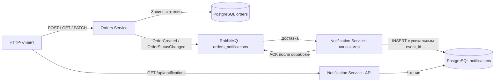

# Лабораторная работа по микросервисам

Orders Service создаёт заказы и меняет их статус. Notification Service получает события из RabbitMQ, сохраняет уведомления и отдаёт их через HTTP API. У каждого приложения своя PostgreSQL.

Стек проекта — PHP 8.3, Symfony 7.4, Doctrine, PostgreSQL 16, RabbitMQ 3 и Docker Compose. Swagger UI позволяет вызвать все маршруты из браузера.

## Быстрый запуск на компьютере с Docker

Открой терминал в папке, где лежит `docker-compose.yml`, и выполни:

```bash
docker compose up -d --build --wait --wait-timeout 120
docker compose ps -a
```

Если Linux требует права администратора, выполни обе команды с `sudo`. Compose собирает PHP-образы, ставит зависимости из `composer.lock`, поднимает PostgreSQL и RabbitMQ и применяет миграции. `Exited (0)` у `orders-migrate` и `notifications-migrate` означает, что миграции завершились успешно.

Открой [Swagger UI](http://127.0.0.1:8088/), выбери `POST /api/orders`, нажми **Try it out** и **Execute**. В ответе будет `201 Created` и `id` нового заказа. Подставь его в `GET /api/notifications` как `order_id`. Если сразу пришёл пустой список, повтори GET через пару секунд.

## Установка с нуля на Windows через VirtualBox

Нужен Windows x64, включённая аппаратная виртуализация и интернет. По умолчанию виртуальной машине выделяется 4 виртуальных ядра, 6 ГБ ОЗУ и динамический диск до 40 ГБ. Debian устанавливается без графического рабочего стола, с SSH.

### 1 Установить VirtualBox и скачать проект

В **PowerShell на Windows** выполни:

```powershell
winget install --id Oracle.VirtualBox --exact --source winget --accept-package-agreements --accept-source-agreements
```

Подтверди запрос Windows на установку, если он появится. Распакуй ZIP с проектом или после публикации скачай его через **Code → Download ZIP** на GitHub. Если удобнее Git, установи его из PowerShell, затем открой новое окно PowerShell:

```powershell
winget install --id Git.Git --exact --source winget --accept-package-agreements --accept-source-agreements
git clone https://github.com/mcaksyo/sit.git microservices-lab
cd microservices-lab
```

При распаковке ZIP перейди в папку, где лежит `docker-compose.yml`. Для следующих шагов сохрани путь к ней:

```powershell
$projectPath = (Get-Location).Path
```

### 2 Создать VM и установить Debian

Из той же папки запусти:

```powershell
powershell.exe -NoProfile -ExecutionPolicy Bypass -File .\scripts\create-debian-vm.ps1
```

Скрипт скачивает официальный Debian 13 amd64 netinst, сверяет SHA-512 и запускает установку в новой VM `Debian SIT Lab`. На вопрос о пароле задай свой пароль для пользователя `lab`. Он понадобится для SSH и `sudo`. Установка выполняется в фоне и занимает несколько минут. При необходимости открой окно VM через менеджер VirtualBox, чтобы посмотреть ход установки.

Если ISO уже скачан и проверен, можно передать его в скрипт:

```powershell
powershell.exe -NoProfile -ExecutionPolicy Bypass -File .\scripts\create-debian-vm.ps1 -IsoPath 'C:\путь\debian-13-amd64-netinst.iso'
```

Если имя VM или порт `2222` уже заняты, задай другое имя и порт, например `-VmName 'SIT Lab 2' -SshPort 3222`. Тогда в командах `ssh` и `scp` ниже укажи выбранный порт.

### 3 Скопировать проект и войти в Debian

Когда установка закончится, выполни в **PowerShell**:

```powershell
$projectArchive = Join-Path $env:TEMP 'microservices-lab-source.tar.gz'
tar.exe -czf $projectArchive --exclude=.git --exclude=vendor --exclude=var --exclude='.env.local*' --exclude='.env.*.local' --exclude='.env.dev' -C $projectPath .
scp -P 2222 $projectArchive lab@127.0.0.1:microservices-lab-source.tar.gz
ssh -o ExitOnForwardFailure=yes -L 8088:127.0.0.1:8088 -p 2222 lab@127.0.0.1
```

При первом входе подтверди ключ SSH, если это адрес только что созданной VM. Последняя команда одновременно открывает терминал Debian и передаёт порт Swagger на Windows. Оставь эту SSH-сессию открытой, пока работаешь в Swagger.

### 4 Установить Docker и запустить систему

В **консоли Debian** выполни:

```bash
mkdir -p ~/microservices-lab
tar -xzf ~/microservices-lab-source.tar.gz -C ~/microservices-lab
cd ~/microservices-lab
sudo bash scripts/install-docker-debian.sh
sudo bash demo/00-start.sh
```

Первый сценарий ставит Docker Engine с Compose из официального репозитория Docker. Второй собирает и запускает всю систему. Открой [Swagger UI](http://127.0.0.1:8088/) в браузере Windows.

### 5 Запустить VM снова после выключения

В **PowerShell**:

```powershell
& "$env:ProgramFiles\Oracle\VirtualBox\VBoxManage.exe" startvm "Debian SIT Lab" --type headless
ssh -o ExitOnForwardFailure=yes -L 8088:127.0.0.1:8088 -p 2222 lab@127.0.0.1
```

В **Debian**:

```bash
cd ~/microservices-lab
sudo docker compose up -d --wait --wait-timeout 120
```

## API и демонстрация

| Метод | Маршрут | Результат |
|---|---|---|
| POST | `/api/orders` | Создаёт заказ. Пример тела — `{"customer_id":100,"amount":"2500.50"}`. |
| GET | `/api/orders/{id}` | Возвращает заказ или 404. |
| PATCH | `/api/orders/{id}/status` | Меняет статус на `created`, `paid` или `cancelled`. Пример — `{"status":"paid"}`. |
| GET | `/api/notifications?order_id={id}` | Показывает уведомления выбранного заказа. Без фильтра возвращает весь список. |

Локальные порты Debian — `8001` для заказов, `8002` для уведомлений, `8088` для Swagger и `15672` для интерфейса RabbitMQ. Для RabbitMQ используются учебные учётные данные `lab` / `lab_password`.

Сценарии запускаются из корня проекта. На свежем Debian с Docker используй `sudo bash demo/ИМЯ.sh`. Когда у пользователя уже есть доступ к Docker, достаточно `bash demo/ИМЯ.sh`.

| Файл | Что показывает |
|---|---|
| `demo/00-start.sh` | Сборку, миграции и состояние контейнеров. |
| `demo/01-api.sh` | Создание, чтение и оплату заказа. Выводит уведомления по его ID. |
| `demo/02-queue.sh` | При выключенном потребителе заказ создаётся, а сообщение ждёт в очереди. После запуска потребителя в базе появляется уведомление. |
| `demo/03-dedup.sh` | Две доставки одного `eventId` дают одну строку в базе. |
| `demo/04-retries.sh` | Сбой базы уведомлений, три повтора, очередь ошибок и обработку после восстановления. |
| `demo/05-workers.sh` | Распределение событий между заданным числом потребителей. Например, `sudo bash demo/05-workers.sh 3 20` запускает трёх потребителей всего и создаёт 20 заказов. |

Сценарии создают тестовые заказы. `02-queue.sh` временно останавливает консьюмер, а `04-retries.sh` временно останавливает базу уведомлений. Запускай их по одному.

## Архитектура



Сервис заказов сохраняет изменения и вызывает публикацию в RabbitMQ. Консьюмер обрабатывает сообщение отдельно. Если он выключен, сообщение ждёт в очереди. При сбое базы уведомлений Messenger повторяет обработку через 1, 2 и 4 секунды, затем переносит сообщение в `orders_notifications_failed`. При повторной доставке PostgreSQL пропускает вставку с уже записанным `event_id`.

В этой реализации сохранение заказа и публикация события выполняются отдельно. При сбое RabbitMQ заказ может сохраниться, а POST завершится ошибкой. Перед повторным POST проверь, сохранился ли заказ.

## Диагностика

```bash
sudo docker compose ps -a
sudo docker compose logs --tail=60 orders notifications notifications-api rabbitmq
sudo docker compose exec -T -u rabbitmq rabbitmq \
  rabbitmqctl -q list_queues name messages_ready messages_unacknowledged
```

- **Windows не открывает Swagger.** Проверь в Debian командой `curl -I http://127.0.0.1:8088/` и убедись, что SSH открыт с `-L 8088:127.0.0.1:8088`. Если на Windows порт занят, используй `-L 18088:127.0.0.1:8088` и открой `http://127.0.0.1:18088/`.
- **Получен 201, но уведомления пока нет.** Проверь `notifications`, очередь и `order_id`. `messages_ready` показывает, сколько сообщений ждут выдачи.
- **Нужно остановить проект.** Выполни `sudo docker compose down`. Данные сохранятся в томах Docker.

## Публикация на GitHub

Создай пустой репозиторий на GitHub и выполни из папки проекта:

```bash
git init -b main
git add .
git status --short
git commit -m "Add microservices lab"
git remote add origin https://github.com/OWNER/REPOSITORY.git
git push -u origin main
```

В репозиторий входят код, миграции, lock-файлы, Swagger, сценарии запуска и эта инструкция. Учётные данные в Compose предназначены для локальной лабораторной. Свои пароли, SSH-ключи, образы VM и данные баз храни вне Git.

Справка по установке — [VirtualBox VBoxManage](https://docs.oracle.com/en/virtualization/virtualbox/7.2/user/vboxmanage.html), [официальный образ Debian](https://www.debian.org/download), [Docker Engine для Debian](https://docs.docker.com/engine/install/debian/).
